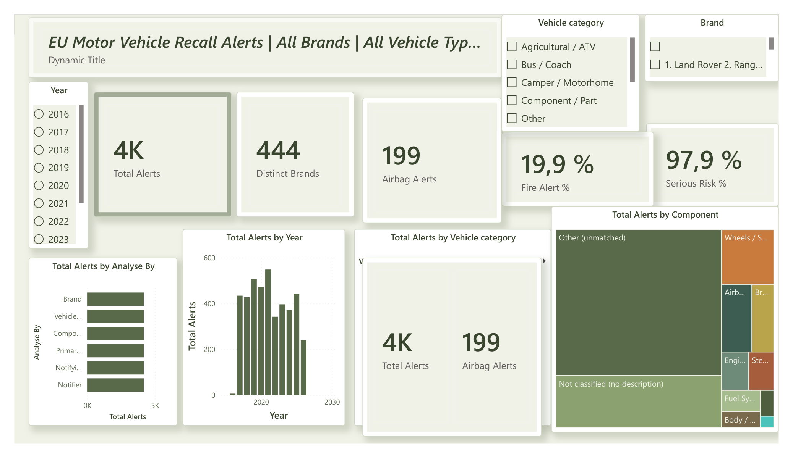
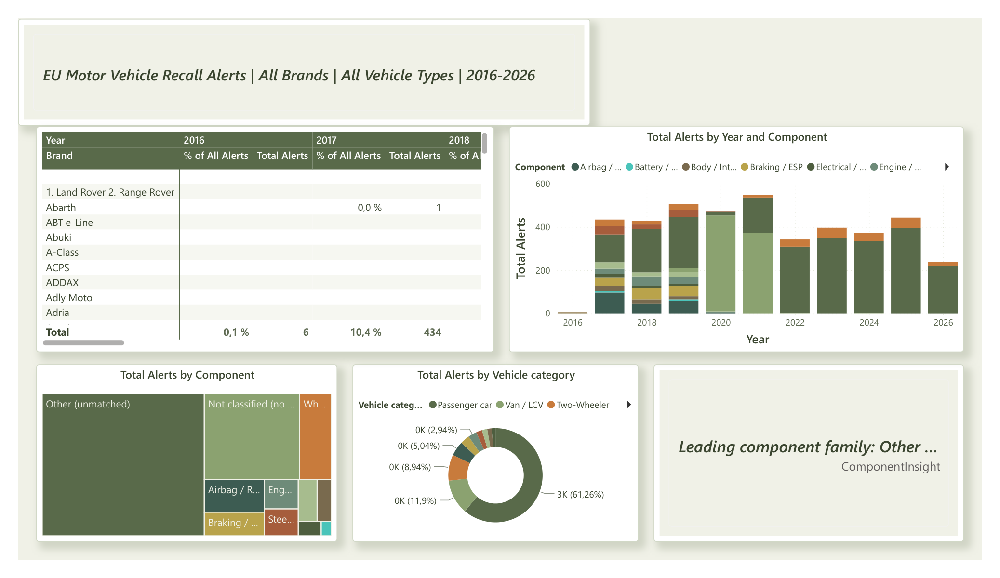
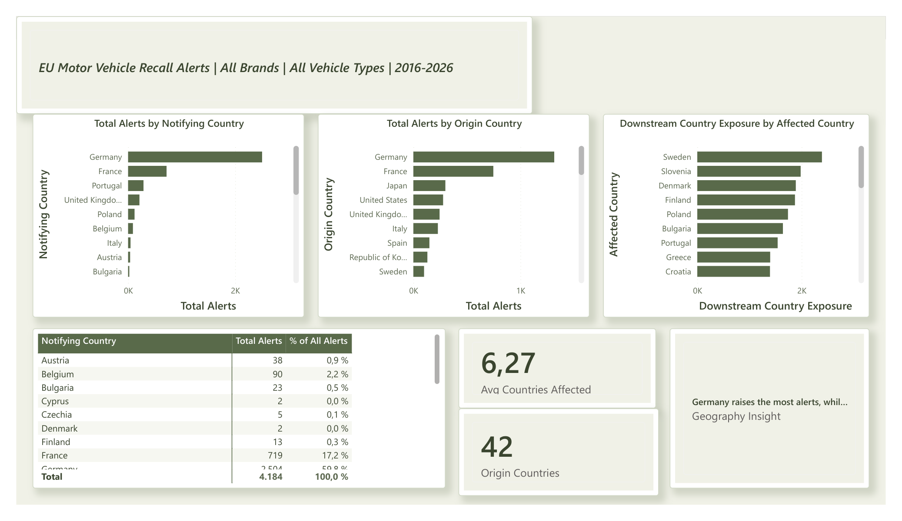
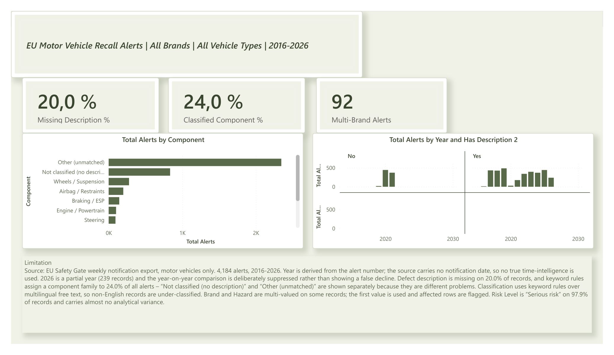

# EU Safety Gate Motor Vehicle Recalls Dashboard

An interactive Power BI dashboard on **4,184 motor-vehicle recall alerts** (2016–2026) from the
[EU Safety Gate](https://ec.europa.eu/safety-gate-alerts/) rapid alert system: who raises the
alerts, which brands, vehicle types and components they concern, and where else in Europe the
same vehicles were found.

Every headline number on the report is recomputed independently in Python
([`checks/verify_counts.py`](checks/verify_counts.py)) and the two agree exactly.



## Key numbers

| | |
|---|---|
| Alerts | **4,184** (2016–2026; 2026 is a partial year with 239) |
| Busiest year | **2021**, 548 alerts (+16.1% on 2020) |
| Rated "Serious risk" | **97.9%** of alerts |
| Fire as a hazard | **19.9%** of alerts |
| Brands | **444** distinct brands; Mercedes-Benz has the most alerts (477) |
| Notifying country | Germany raises **2,504** of the 4,184 alerts (59.8%) |
| Country of origin | Germany (1,316), France (747), Japan (299) |
| Spread | an alert lists **6.27** other affected countries on average |
| Airbag / restraint alerts | **199** |
| Data quality | defect description missing on **20.0%**; keyword rules classify **24.0%** into a component family |

## Report pages

| Page | What it shows |
|---|---|
| **Overview** | KPI cards, alerts by year, vehicle category and component, with year, vehicle-category and brand slicers |
| **Drivers** | Brand × year matrix, alerts by year and component, component insight |
| **Geography** | Notifying vs origin country, downstream exposure by affected country |
| **Data Quality** | Missing descriptions, classification coverage, multi-brand alerts and the report's limitations |

| | |
|---|---|
|  |  |
|  | |

## Data

The EU Safety Gate "search list" export for motor vehicles, downloaded on 2 August 2026
([`data/safety_gate_motor_vehicles_2026-08-02.xlsx`](data/)). One row per alert. The export has
no notification date, so the year comes from the alert number (`A12/0028/17` → 2017).

## How it is built

- **Power Query** ([`power-query/`](power-query/)): `Recall` cleans the export (header rows,
  trimming, brand spelling, first brand of multi-brand alerts) and derives the year, vehicle
  category and defective component with ordered, case-insensitive keyword rules.
  `AffectedCountries` splits the "also found in" list into one row per alert and country.
- **Model**: `Recall` (fact), `AffectedCountries` (many → one on alert number), `DimYear`
  (one → many on year), plus `Top N` and `Analyse By` helper tables for the slicers.
- **DAX** ([`dax/measures.dax`](dax/measures.dax)): 30 measures, including year-on-year that is
  suppressed for the partial current year, dynamic titles and text insights.
- **Theme**: [`MOTOR_Executive_Theme.json`](MOTOR_Executive_Theme.json).

## Validation and fixes

Checking the first version of the report against the source data turned up nine problems,
from two alerts lost at the header row to a year table that wasn't connected to the data.
They are fixed in this version; [`FIXES.md`](FIXES.md) lists each one with its effect.

```bash
pip install pandas openpyxl
python checks/verify_counts.py
```

## Limitations

- Component classification uses English keyword rules on multilingual free text, so 56% of
  alerts stay "Other (unmatched)" and 20% have no description at all.
- Brand and hazard can hold several values; the first brand is used and the alert is flagged.
- Nearly every alert is "Serious risk", so risk level barely separates alerts.

## Open it

Open `EU_Safety_Gate_Motor_Recalls.pbix` in Power BI Desktop. If the data path differs on your
machine, change `DataFile` at the top of the `Recall` query (Transform data → Advanced Editor).

Data: © European Union, EU Safety Gate, reused under the Commission's reuse policy
(Decision 2011/833/EU).
